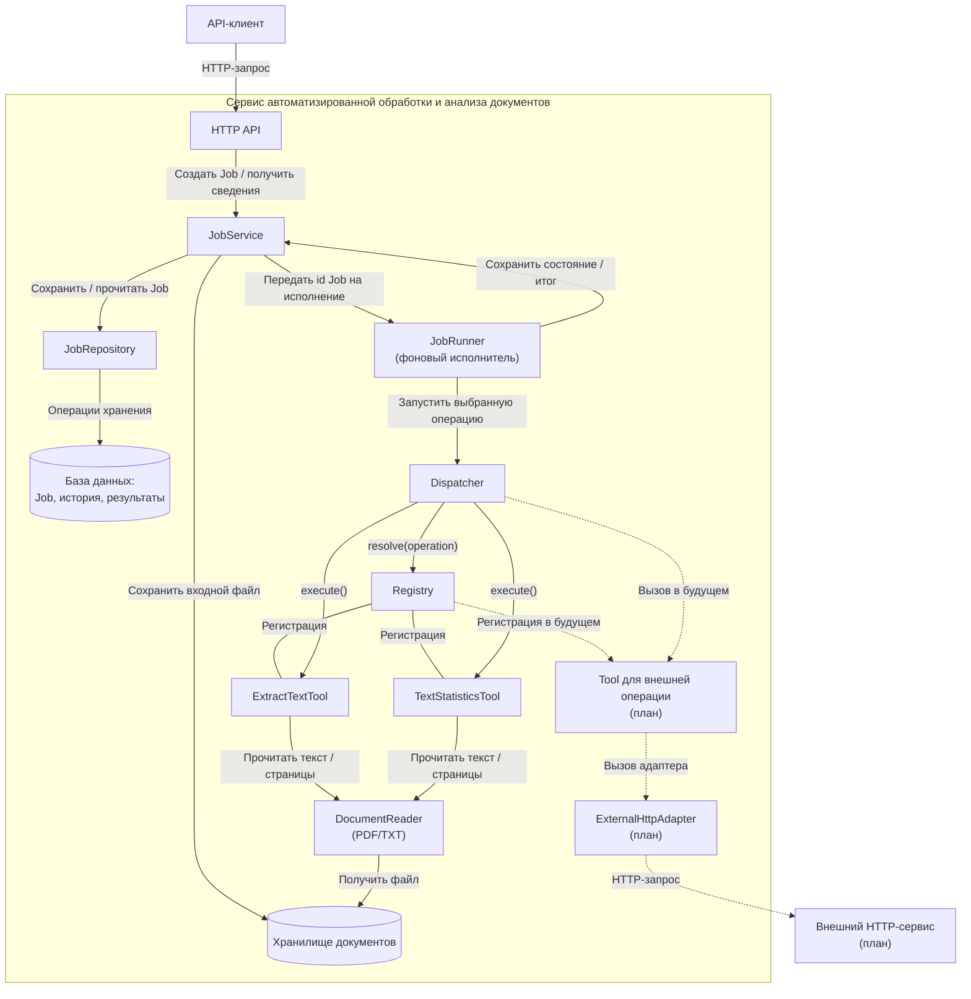
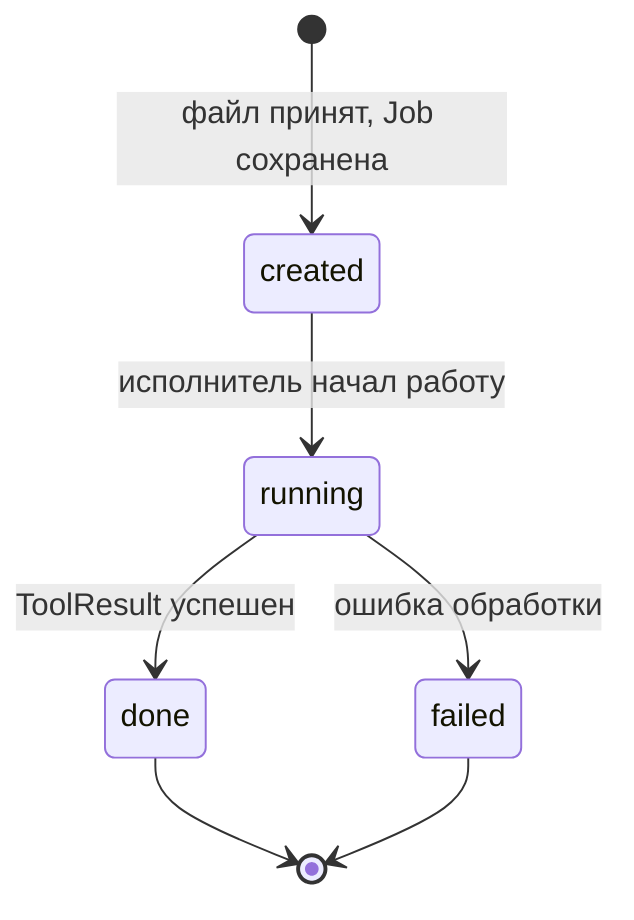

# Архитектура сервиса автоматизированной обработки и анализа документов

## 1. Назначение и границы

Сервис принимает один PDF- или TXT-документ на одну операцию, создаёт задачу (**Job**), обрабатывает документ и сохраняет состояние и результат. Клиент взаимодействует с системой через HTTP API.

В первой версии предусмотрены:

- `extract_text` — извлечение текста из TXT в UTF-8 и PDF с текстовым слоем;
- `text_statistics` — подсчёт слов и символов, а для PDF также количества страниц;
- получение статуса, результата и истории Job;
- обработка ошибок неподдерживаемого формата, повреждённого PDF и отсутствия извлекаемого текста.

Ограничения: один документ на Job; OCR, полноценный веб-интерфейс и LLM не входят в MVP; максимальный размер файла **предлагается** ограничить 10 МБ (значение должно быть подтверждено контрактом API). Работа с конфиденциальными документами в учебном MVP не предусмотрена.

## 2. Контекст системы (C4 — Context)

На этой схеме сервис показан **одним блоком**: внутренняя реализация здесь не рассматривается.

**Смысл стрелок:** сплошные стрелки обозначают реальные типы HTTP-взаимодействия клиента с проектируемым сервисом; пунктирные — **планируемую** внешнюю HTTP-интеграцию. Стрелки здесь не обозначают зависимости исходного кода. Конкретный внешний сервис ещё не утверждён; его назначение и правила отказа будут согласованы с командой.

**Участники контекста:**

| Элемент | Роль |
|---|---|
| Пользователь / API-клиент | Отправляет файл и выбранную операцию, получает идентификатор Job, затем запрашивает состояние и результат. |
| Наш сервис | Управляет задачей, вызывает инструменты, сохраняет результаты и возвращает ответы API. |
| Внешний HTTP-сервис | Планируемая внешняя зависимость для дополнительной функции; основное чтение PDF/TXT выполняется локально. |

## 3. Компоненты системы

В качестве отправной точки предлагается **модульный backend** с отдельными ответственностями внутри приложения.

**Смысл связей:** направленные сплошные стрелки обозначают вызовы компонентов или обращения к хранилищам во время выполнения. Линии без направления между Registry и Tool обозначают регистрацию инструментов, а не их выполнение. Dispatcher получает инструмент через Registry и самостоятельно вызывает `Tool.execute()`. Пунктирные стрелки показывают планируемое расширение через внешний HTTP API.

Схема отображает взаимодействия компонентов во время работы системы, а не зависимости исходного кода. Обратные стрелки для результатов вызовов опущены ради читаемости.

### Ответственность компонентов и скрываемые детали

| Компонент | За что отвечает | Что скрывает от соседей |
|---|---|---|
| **HTTP API** | Принимает файл, операцию и запросы статуса; возвращает HTTP-ответы. | HTTP-маршруты, сериализацию, проверку формата запроса и HTTP-коды. |
| **JobService** | Создаёт Job, проверяет ключ идемпотентности, управляет состояниями и получением результатов. | Правила предметной области и проверки допустимых переходов. |
| **JobRepository** | Сохраняет и читает Job, историю состояний, результаты и сведения об идемпотентности. | SQL-запросы и устройство таблиц. |
| **База данных** | Хранит устойчивые сведения о задачах и их результатах. | Физическое представление и механизмы хранения данных. |
| **Хранилище документов** | Сохраняет входной файл и предоставляет его по ссылке для обработки. | Путь к файлу и способ физического хранения. |
| **JobRunner** | Выполняет Job вне HTTP-запроса и передаёт итог в JobService. | Механизм фонового запуска, расписание и детали исполнения. |
| **Dispatcher** | Находит нужный инструмент через Registry и вызывает его по общему контракту. | Выбор конкретной реализации Tool и обработку единого ToolResult. |
| **Registry** | Сопоставляет имя операции с реализацией Tool. | Способ регистрации и хранения ссылок на инструменты. |
| **ExtractTextTool** | Реализует операцию extract_text: получает текст через DocumentReader и возвращает его в формате ToolResult. | Формирование результата операции и обработку специфичных для неё ошибок. |
| **TextStatisticsTool** | Реализует операцию text_statistics: получает текст через DocumentReader, подсчитывает слова и символы, возвращает статистику. | Правила подсчёта и формирование результата статистики. |
| **DocumentReader** | Предоставляет обоим инструментам единый способ чтения PDF и TXT, возвращая текст и количество страниц. | PyMuPDF, декодирование TXT и технические детали работы с форматами. |
| **Tool для внешней операции (план)** | В будущем предоставляет дополнительную операцию через тот же интерфейс Tool. | Специфику выбранного внешнего API. |
| **ExternalHttpAdapter (план)** | Выполняет вызовы внешнего HTTP API с timeout, обработкой ошибок, предусмотренными retry и fake-реализацией для тестов. | HTTP-клиент, протокол поставщика и сетевые сбои. |

**Примечание о контрактах:** два обязательных Tool — `ExtractTextTool` и `TextStatisticsTool` — возвращают единый `ToolResult`.

### Типичный путь запроса

1. Пользователь отправляет поддерживаемый файл и операцию через **HTTP API**.
2. HTTP API проверяет запрос и передаёт его в **JobService**. Неподдерживаемый формат отклоняется **до создания Job** (`UNSUPPORTED_FORMAT`).
3. **JobService** проверяет ключ идемпотентности и параметры запроса. Если Job с таким ключом и идентичными параметрами уже существует, система возвращает её идентификатор без создания новой задачи и повторного сохранения документа. Для нового запроса документ сохраняется в хранилище, после чего создаётся Job в состоянии `created`. Если ключ совпадает, но содержимое запроса отличается, возвращается ошибка конфликта (`409 Conflict`). Проверка и регистрация ключа должны исключать создание двух Job при одновременных одинаковых запросах.
4. **JobRunner** получает идентификатор Job, переводит задачу через JobService в `running` и вызывает **Dispatcher**.
5. Dispatcher через **Registry** находит нужный Tool; Tool читает документ через **DocumentReader** и возвращает `ToolResult`.
6. При успехе JobService сохраняет результат и переводит Job в `done`; при ошибке инструмента — сохраняет код/описание ошибки и переводит Job в `failed`.
7. Пользователь отдельно запрашивает состояние и готовый результат. Для `created` и `running` окончательный результат не выдаётся.

### Поведение при перезапуске исполнителя

Для первой версии предлагается следующий механизм восстановления после перезапуска приложения:

1. JobRunner проверяет сохранённые Job в базе данных.
2. Задачи в состоянии `created` могут быть повторно поставлены на выполнение.
3. Задачи, оставшиеся в состоянии `running` после остановки исполнителя, переводятся в `failed` с кодом ошибки `WORKER_INTERRUPTED`.
4. Успешно завершённые (`done`) и ошибочные (`failed`) задачи не запускаются повторно.
5. История изменения состояний сохраняется.

## 4. Диаграмма состояний Job

Одна Job относится к **одному документу** и **одной операции**. Разрешены ровно следующие переходы:

**Смысл стрелок:** это **допустимые изменения состояния**.  Переходы в начальное и конечное псевдосостояния показывают создание и завершение жизненного цикла.

| Состояние | Значение |
|---|---|
| `created` | Задача зарегистрирована и ожидает запуска. |
| `running` | Исполнитель обрабатывает документ. |
| `done` | Результат успешно сохранён и доступен клиенту. |
| `failed` | Причина неудачи сохранена; задача не запускается повторно в MVP. |

### Запрещённые переходы и ответ системы

**Запрещён любой переход, отсутствующий на диаграмме**, в частности:

- `created → done` и `created → failed`: задачу нельзя завершить, минуя `running`;
- `running → created`: нельзя вернуть уже запущенную задачу в очередь простым изменением статуса;
- `done → running`, `done → failed`, `done → created`: завершённая задача неизменяема;
- `failed → running`, `failed → done`, `failed → created`: повторный запуск или исправление ошибочной Job не поддерживаются;
- повторные записи того же статуса не считаются новым переходом.

**Реакция системы:** проверку допустимости переходов выполняет JobService. При попытке недопустимого перехода он возвращает доменную ошибку `INVALID_JOB_TRANSITION`, не изменяя состояние Job и её историю.
Прямое изменение статуса через публичный HTTP API в MVP не предусмотрено. Если ошибка перехода возникает при выполнении доступной HTTP-операции, она отображается в предусмотренный контрактом ответ, например `409 Conflict`, с единым форматом ошибки.
Точные HTTP-коды и структура тела ошибки определяются в `docs/api/openapi.yaml`.

**Ошибки файлов:**

- Неподдерживаемый тип (`UNSUPPORTED_FORMAT`) отклоняется на этапе приёма запроса; **Job не создаётся** (UC-05).
- Повреждённый PDF обнаруживается при обработке, приводит к `running → failed` и ошибке `DOCUMENT_CORRUPTED` (UC-06).
- Корректный PDF без извлекаемого текста приводит к `running → failed` с `TEXT_NOT_FOUND`; OCR не выполняется.
- Запрос результата до завершения обработки возвращает текущий статус, но не выдаёт незавершённые данные как готовый результат (UC-04).

## 5. Вопросы для синхронизации команды перед объединением PR

Это **не дополнительные требования P1**, а вопросы реализации, которые должны получить одинаковый ответ в ADR, `openapi.yaml` и контракте Tool:

1. **Исполнение Job:** JobRunner работает в процессе API или отдельным worker? Как поступаем с Job после перезапуска процесса?
2. **Хранение документа:** локальное файловое хранилище или другое решение? Как долго сохраняются входные файлы?
3. **Идемпотентность:** как сравниваем параметры повторного запроса и какой код ответа возвращаем при повторе или конфликте ключа?
4. **Внешний HTTP API:** какую дополнительную функцию он предоставляет и как система отвечает на timeout/недоступность?
5. **Контракт статистики:** как именно считаются слова, символы и страницы, чтобы результат можно было однозначно проверить тестами?

После согласования решения следует отразить в соответствующих документах. Если изменяются состояния или компоненты, нужно обновить и эту архитектуру.
